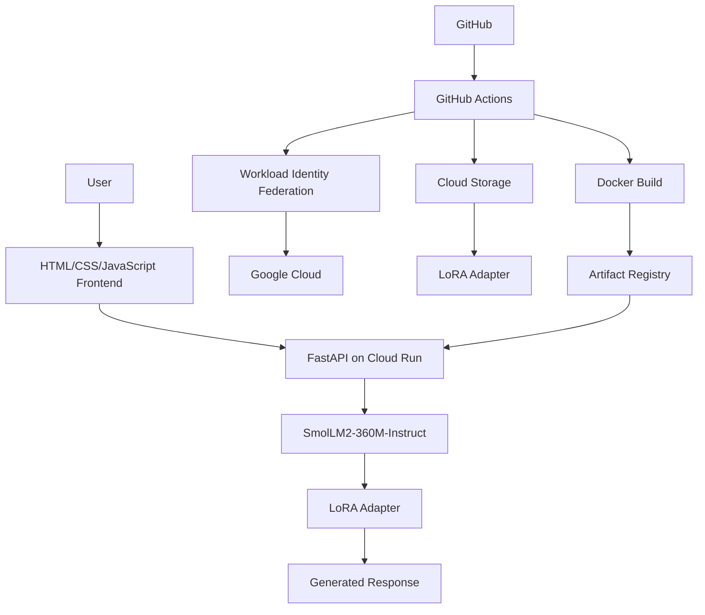
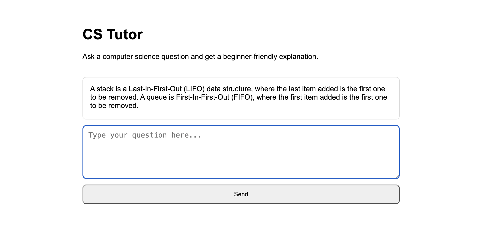
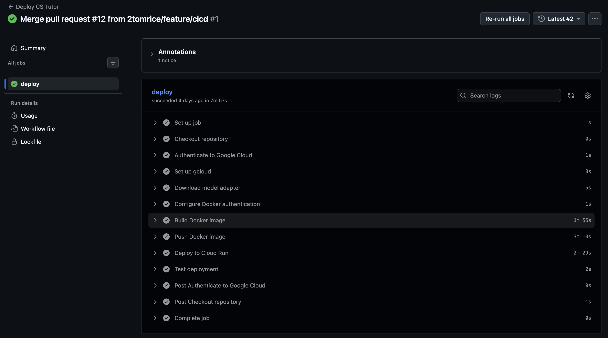

# Fine-Tuned CS Tutor LLM 
## Overview
This project explores the end-to-end machine learning and cloud deployment pipeline for a beginner friendly computer science tutor.
I generated and quality-reviewed a domain-specific CS dataset, fine-tuned the open-source 'SmolLM2-360M-Instruct' model using LoRA, evaluated the fine-tuned model against base model, exposed inference via FastAPI, containerised the application with Docker, and deployed using Google Cloud Run. It had a lightweight frontend which communicates with deployed API, while Github Actions provides automated CI/CD deployment when changes merged into 'main'.

## Architecture

User
  ↓
Web Frontend
  ↓
Cloud Run HTTPS API
  ↓
FastAPI
  ↓
SmolLM2-360M + LoRA Adapter
  ↓
Generated Response

Deployment pipeline:

GitHub
  ↓
GitHub Actions
  ↓
Cloud Storage (LoRA adapter)
  ↓
Docker Build
  ↓
Google Artifact Registry
  ↓
Google Cloud Run


## Tech Stack

- Python
- PyTorch
- Hugging Face Transformers
- PEFT / LoRA
- TRL
- FastAPI
- Docker
- Google Cloud
- Vertex AI / Gemini
- BigQuery
- Cloud Storage
- Artifact Registry
- Cloud Run
- GitHub Actions
- HTML / CSS / JavaScript

## Dataset and Fine-Tuning 

The model was specialised for begginer friendly computer science tutoring trained on a structured synthetic dataset of 10 topics, such as data structures, algorithms, complexity, databases, operating systems, networking and software engineering.

the initial dataset was 200 examples generated via Gemini through Vertex AI. Then rather than using generated data directly I built a validation and review pipeline: 

- validate the JSONL conversation structure
- inspect random samples for technical accuracy
- record reviewed corrections separately
- apply corrections reproducibly during preprocessing
- analyse topic distribution and message structure using BigQuery

The original dataset had a split of:

- 180 training examples
- 20 held-out evaluation examples
- 2 evaluation examples from each of the 10 topics

A fixed random seed was used so the train/evaluation split remained reproducible.

After evaluation exposed a weakness in asymptotic-complexity generalisation, six additional reviewed complexity examples had been added increasing from 180 to 186 examples while keeping 20 review examples the same.

### Model Choice

`HuggingFaceTB/SmolLM2-360M-Instruct` was selected because it provides more capacity than the 135M variant while remaining small enough to fine-tune locally on Apple Silicon as this was the device used during the project.

### LoRA Fine-Tuning

Rather than fully fine-tuning all model parameters, I had chosen to use parameter efficient fine-tuning instead via LoRa.

Approximately:

- 363.5 million total parameters
- 1.64 million trainable parameters
- 0.45% of the model parameters updated during training

The LoRA adapters were applied to the model's attention projection layers.

Training consisted of:

- 3 epochs
- batch size 1
- gradient accumulation of 4
- learning rate of `2e-4`
- 512-token maximum sequence length

Training was performed locally using PyTorch's MPS backend on Apple Silicon.

## Evaluation Results 

the fine-tuned model was evaluated using the same 20 set examples used throughout experimentation.

| Model | Training Examples | Final Eval Loss | Eval Token Accuracy |
|---|---:|---:|---:|
| LoRA V1 | 180 | 1.430 | ~0.666 |
| LoRA V2 | 186 | 1.423 | ~0.668 |

The second fine-tuning run produced a small improvement in held-out evaluation loss and token accuracy.

Although, manual response comparison had shown that despite lower evaluation loss it did not guarantee better factual answers, the model had improved responses towards such things like binary-trees and searches, but still produced an incorrect explanation for one Big-O question.

Additional sanity checks had also shown that the model had learnt the newly added complexity examples but did not generalise that knowledge to differently worded questions.

This ultimately highlighted an important limitation of the small model and dataset: fine-tuning successfully changed model behavior, but factual accuracy still required manual evaluation rather than relying only on training metrics.

## API and inference Service

The fine-tuned model is exposed through a FastAPI application.

The API provides:

- a `/generate` endpoint for model inference
- a `/health` endpoint for deployment health checks
- request validation using Pydantic
- CORS configuration so the browser frontend can communicate with the deployed API

The model and LoRa are loaded when the application starts, allowing inference requests to reuse the same model instance.

## Containerisation

The inference service is containerised using Docker.

The production image contains:

- the FastAPI application
- the Python inference dependencies
- the trained LoRA adapter
- the configuration required to run the API with Uvicorn

A seperate 'requirements-api.txt` file is used for production so deployment image does not include unnecessary training data and dataset-generation dependencies.

The container listens on the port supplied by the deployment environment, with `8080` used as the default.

## Google Cloud Deployment 

The application is deployed on Google Cloud using several managed services:

- **Cloud Storage** stores the trained LoRA adapter used during CI/CD builds.
- **Artifact Registry** stores versioned Docker images.
- **Cloud Run** runs the containerised FastAPI inference service.
- **BigQuery** is used to analyse the generated training dataset.
- **Vertex AI / Gemini** was used during synthetic dataset generation.

## CI/CD

Deployment is automated using GitHub Actions.

When changes are merged into `main`, the workflow:

1. checks out the repository
2. authenticates to Google Cloud using Workload Identity Federation
3. downloads the LoRA adapter from Cloud Storage
4. builds the Docker image
5. tags the image using the Git commit SHA
6. pushes the image to Artifact Registry
7. deploys the new image to Cloud Run
8. performs a health-check smoke test against the deployed API

Workload Identity Federation is used instead of storing a long-lived Google Cloud service-account key in GitHub.

Using the Git commit SHA as the container image tag makes each deployment traceable to the exact source-code revision that produced it.

## Frontend

A lightweight frontend was built using plain HTML, CSS and JavaScript.

The interface allows a user to:

- enter a computer science question
- send the question to the deployed `/generate` API endpoint
- display a loading state while inference is running
- display the generated tutor response
- handle failed API requests gracefully

The frontend communicates with the Cloud Run API using the browser `fetch` API.

Frontend was kept simple rather than using Frontend framework to allow for more focus on backend, machine learning and cloud deployment.

## Limitations

This project was designed as a portfolio-scale ML system rather than a production tutoring platform.

Current limitations include:

- the fine-tuned model has only 360 million parameters, limiting reasoning and factual reliability
- the training dataset is relatively small
- improvements in evaluation loss do not always translate to better generated answers
- the model can still produce incorrect or incomplete explanations
- inference currently runs on CPU in Cloud Run
- the base model is downloaded from Hugging Face during a new container cold start
- the API is publicly accessible and does not currently use authentication or rate limiting
- Cloud Run concurrency and maximum instance count are intentionally restricted to control resource usage and cost
- the frontend is currently run locally rather than hosted as a separate public website

## Future Improvements

Possible improvements include:

- expand the reviewed training dataset with more diverse CS questions
- evaluate using a larger and more comprehensive held-out benchmark
- introduce automated response-quality evaluation alongside manual review
- experiment with larger base models
- add retrieval-augmented generation for questions based on course notes or PDFs
- cache or package the base model with the deployment to reduce external dependencies during cold starts
- add API authentication and rate limiting
- add automated tests to the CI pipeline before deployment
- host the frontend publicly
- add monitoring for latency, failures and model usage

## Project Structure

```text
llm-project/
├── app/
│   ├── main.py
│   └── model_service.py
├── scripts/
│   ├── generate_dataset.py
│   ├── inspect_dataset.py
│   ├── prepare_dataset.py
│   ├── validate_data.py
│   ├── train_model.py
│   └── evaluate_model.py
├── data/
│   ├── raw/
│   ├── processed/
│   └── review/
├── frontend/
│   ├── index.html
│   ├── styles.css
│   └── app.js
├── .github/
│   └── workflows/
│       └── deploy.yml
├── Dockerfile
├── requirements.txt
├── requirements-api.txt
└── README.md
```


## Running Locally

### Clone the repository

```bash
git clone https://github.com/2tomrice/llm-project.git
cd llm-project
```

### Create a virtual environment

```bash
python -m venv .venv
source .venv/bin/activate
```

### Install dependencies

```bash
pip install -r requirements.txt
```

### Run the frontend

The frontend can be served locally with:

```bash
python -m http.server 5500 --directory frontend
```

Then open:

```text
http://localhost:5500
```

The frontend currently sends inference requests to the deployed Cloud Run API.

### Run the API locally

The API can also be run locally using Uvicorn:

```bash
uvicorn app.main:app --host 127.0.0.1 --port 8000
```

The API will be available at:

```text
http://127.0.0.1:8000
```

Local model inference requires the trained LoRA adapter to be available at the configured adapter path. The adapter itself is not stored in Git because model artifacts are managed separately using Google Cloud Storage.

## Deployment

The inference API is deployed to Google Cloud Run as a Docker container.

Deployment is automated using GitHub Actions. When changes are merged into `main`, the CI/CD workflow:

1. authenticates to Google Cloud using Workload Identity Federation
2. downloads the trained LoRA adapter from Cloud Storage
3. builds the Docker image
4. tags the image with the Git commit SHA
5. pushes the image to Artifact Registry
6. deploys the new revision to Cloud Run
7. verifies the deployment using the `/health` endpoint

The frontend is currently served locally and communicates with the deployed Cloud Run API.

## Live Deployment

The inference API is deployed on Google Cloud Run:

`https://cs-tutor-api-32775674218.europe-west2.run.app`

Health check:

`https://cs-tutor-api-32775674218.europe-west2.run.app/health`

## System Architecture



## Screenshots

### CS Tutor Frontend



### CI/CD Deployment



